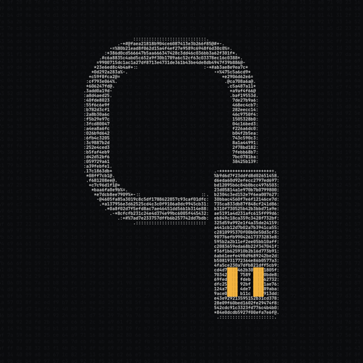

<p align="center"></p>

# qUSB

A quantum-proof cold wallet you make from any USB stick.

No chip, no vendor, no firmware. The stick holds an encrypted keystore and the `qusb` binaries. Your SOL sits in **qvaults**: Solana addresses guarded by Winternitz one-time signatures (hash-based, SHA-256) and checked on-chain by the `qvault` program. There's no elliptic curve, so Shor's algorithm has nothing to break.

> **v1, unaudited.** Don't store more than you can afford to lose. Read [THREAT-MODEL.md](THREAT-MODEL.md) first.

## How it works

```
any USB stick ──▶ qusb init ──▶ 24 words + passphrase, keystore encrypted on the stick
                  qusb receive ─▶ a fresh vault address (send SOL from any wallet)
   offline:       qusb sign ───▶ .qsig (one vault, one recipient, one amount)
   online:        qusb broadcast ▶ qvault verifies the WOTS signature on-chain, SOL moves
```

- **Keys** are decrypted only in RAM while signing, then zeroized. The keystore is Argon2id (64 MiB, t=3) + XChaCha20-Poly1305.
- **Each vault key signs exactly once.** On a partial send the change moves to the next vault automatically.
- **Recovery:** everything re-derives from the 24 words. Sealed backups to a second stick use ML-KEM-768 + X25519.
- **Classic lane:** a normal Ed25519 key (`m/44'/501'/0'/0'`, the same one Phantom derives) pays fees and holds SPL tokens. It's quantum-exposed and the CLI labels it that way.

## Numbers

| | |
|---|---|
| WOTS signature | 840 bytes (N=28, W=256, 30 chains) |
| Withdraw transaction | ~1204 bytes (limit 1232) |
| Compute | ~708k CU sweep, ~859k CU partial send |
| Program | ~17 KB, one instruction, no admin key |
| qvault program ID | `CnfS7soDNtZaJgshcU38tvDuK2zZZwFPAedRUdRmdwZ2` |

## Repo

| Path | What |
|---|---|
| `crates/qusb-wots` | WOTS, `no_std`, shared by the signer and the on-chain program |
| `crates/qusb-core` | mnemonic, key derivation, keystore, seal, withdraw message |
| `crates/qusb-cli` | the `qusb` binary |
| `programs/qvault` | the Solana program (pinocchio) |
| `scripts/make-stick.sh` | flash a release onto a stick |
| `scripts/verify-release.sh` | check release binaries against `SHA256SUMS` |
| `stick/START-HERE.txt` | the readme that ships on every stick |
| [SPEC.md](SPEC.md) | the protocol; if the code disagrees with it, the code is wrong |

## Build and test

```sh
cargo test --workspace --exclude qvault
cd programs/qvault && cargo test           # program tests (needs the Agave toolchain)
cargo build-sbf --manifest-path programs/qvault/Cargo.toml
```

## Make a stick

```sh
scripts/make-stick.sh /Volumes/MYSTICK v0.1.0   # downloads the release binaries + SHA256SUMS, verifies, copies
# refuses anything that isn't a removable volume
```

Then follow `START-HERE.txt` on the stick: `qusb init`, `qusb receive`, `qusb sign`, `qusb broadcast`. `qusb --help` lists everything (`status`, `send`, `classic`, `seal`, `unseal`, `verify`, `wipe-check`).

## Funding

No VC, no sales, no paid marketing. qUSB is funded by $qUSB (`9NDY4jY5gqcNfDrZsKujtnuvH12pPG5FUGS5QmwZpump`). The creator fees pay the dev and the team to build it. The token gives no claim on anything, and the code stays open source whatever happens.

## Security

Non-sensitive bugs: open an issue. Anything that could lose funds: contact [@prfa](https://x.com/prfa) privately first.

## License

MIT or Apache-2.0, at your option.

Built by [prfa](https://x.com/prfa) · [qusb.app](https://qusb.app)
